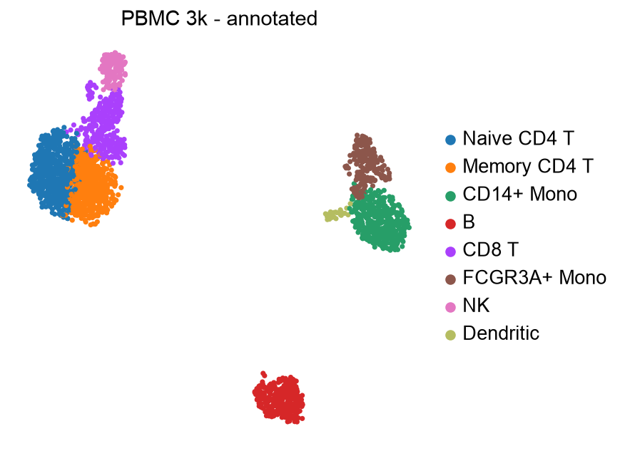
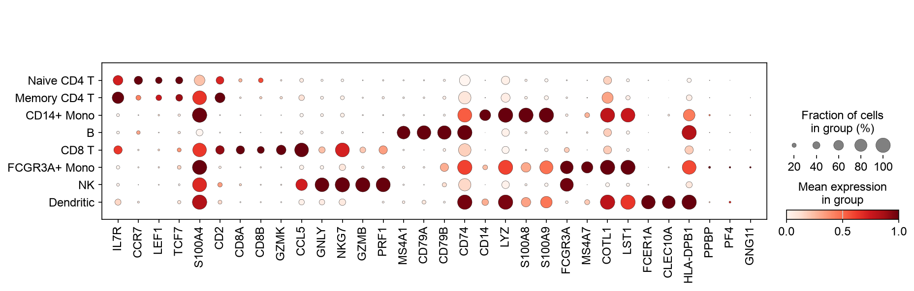
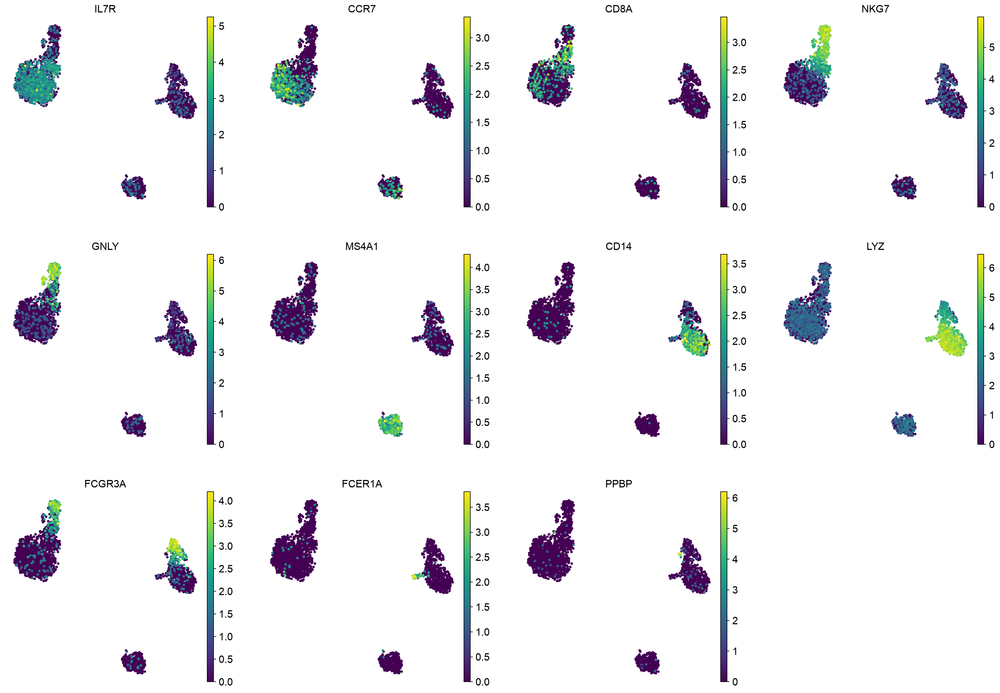

# PBMC 3k single-cell RNA-seq: scverse best-practices walkthrough

An end-to-end, reproducible analysis of the 10x Genomics PBMC 3k dataset (2,700 peripheral blood mononuclear cells, healthy donor), from raw count matrix to annotated immune cell types, using [scanpy](https://scanpy.readthedocs.io) and the scverse ecosystem.



## Contents

| Path | What it is |
|---|---|
| `notebooks/pbmc3k_walkthrough.ipynb` | Teaching notebook, executed, with the reasoning for each step |
| `src/pbmc3k_pipeline.py` | Reusable CLI/library version of the same pipeline |
| `figures/` | All figures (QC, HVG, PCA, UMAP, markers, composition) |
| `requirements.txt` | Pinned versions used for the results below |
| `data/`, `results/` | Unpacked input and output `.h5ad` (git-ignored; regenerated below) |

## Reproduce

```bash
python3.12 -m venv .venv && source .venv/bin/activate
pip install -r requirements.txt
mkdir -p data && tar -xzf pbmc3k_filtered_gene_bc_matrices.tar.gz -C data
python src/pbmc3k_pipeline.py            # writes figures/ and results/pbmc3k_annotated.h5ad
jupyter lab notebooks/pbmc3k_walkthrough.ipynb
```

Options: `--resolution`, `--n-pcs`, `--n-hvg`, `--input`, `--figdir`, `--output`. All stochastic steps use `random_state=0`.

## Methods and decisions

| Step | Choice | Why |
|---|---|---|
| Load | `read_10x_mtx`, gene symbols, de-duplicated | Standard 10x import |
| QC metrics | counts, genes, % mito / ribo / haemoglobin, % in top-20 genes | Distinguish damaged, empty and oversized droplets |
| Cell filter | **5 MADs** on log total counts, log genes, % top-20 genes and % mito; mito also capped at 8% | Adaptive per dataset, following scverse best practices. 3 MADs on mito was tested and removed ~212 cells (MAD is only ~0.5%), too aggressive for healthy PBMCs; 5 MADs removes 76 and matches the classic 5% rule |
| Gene filter | detected in ≥ 3 cells | Remove uninformative genes |
| Normalise | scale to 10,000 counts + `log1p`; raw counts kept in `layers["counts"]` | Correct depth differences, stabilise variance |
| HVG | top 2,000 (`seurat` flavour) | Focus PCA on informative genes |
| PCA | scale (clip ±10), 50 PCs, use 30 | 30 PCs is past the variance elbow |
| Graph | kNN, k = 15, 30 PCs | Scanpy default region, stable for ~2.5k cells |
| Clustering | Leiden (`leidenalg`), resolution 1.0 | 0.5 produced 5 clusters merging CD4/CD8/NK and the monocyte subsets; 1.0 resolves them |
| Embedding | UMAP | Visualisation only |
| Annotation | Wilcoxon DE per cluster, then canonical marker-set scores (`score_genes`) averaged per cluster, argmax label | Auditable and reproducible; score table is shown in the notebook |

### Choices I changed after looking at results
- The first marker set labelled the FCGR3A+ monocyte cluster as CD14+ Mono because `CST3` and `AIF1` are shared across monocytes. I replaced shared genes with discriminating ones (`S100A8/9` vs `FCGR3A/MS4A7/COTL1`).
- Mito threshold and clustering resolution adjusted as described in the table above.

## Results

2,700 cells → **2,541 cells × 13,542 genes** after QC; 8 Leiden clusters mapped to 8 cell types.

| Cell type | Cells | % |
|---|---|---|
| Naive CD4 T | 608 | 23.9 |
| Memory CD4 T | 526 | 20.7 |
| CD14+ Mono | 406 | 16.0 |
| B | 329 | 12.9 |
| CD8 T | 301 | 11.8 |
| FCGR3A+ Mono | 204 | 8.0 |
| NK | 139 | 5.5 |
| Dendritic | 28 | 1.1 |

Composition (~56% T, ~24% monocytes, ~13% B, ~5.5% NK, ~1% DC) matches expectations for healthy PBMC. The annotated clusters agree with the labels in the classic Seurat/scanpy PBMC 3k tutorials.

| | |
|---|---|
|  |  |

## Limitations

- No ambient RNA correction or doublet detection (Scrublet/scDblFinder); both are standard for production data.
- A ~14-cell platelet population described in older tutorials is not a separate cluster here.
- Naive vs memory CD4 T is a continuum; the boundary is a resolution choice, not a hard biological line.
- Marker-based annotation is manual and does not scale to atlases; CellTypist or scANVI reference mapping would be the next step.
- Single donor, single sample: no batch integration needed or demonstrated.

## Why this matters for immunology and drug discovery

Bulk blood profiling averages over cell types, so a drug that depletes B cells or expands cytotoxic T cells appears as a blurred expression shift. Single-cell resolution shows *which* population responds, enabling target discovery in specific subsets, pharmacodynamic tracking of composition and activation state, and biomarker-based patient stratification. Every downstream claim (differential expression, cell-cell communication, trajectories) inherits the quality of the QC, normalisation and annotation done here, which is why this foundation deserves care.

## Data and references

- 10x Genomics, *3k PBMCs from a Healthy Donor* (Chromium v1, hg19).
- Heumos et al., *Best practices for single-cell analysis across modalities*, Nat Rev Genet 2023 (sc-best-practices.org).
- Wolf, Angerer, Theis, *SCANPY*, Genome Biology 2018. Traag et al., *From Louvain to Leiden*, Sci Rep 2019.
